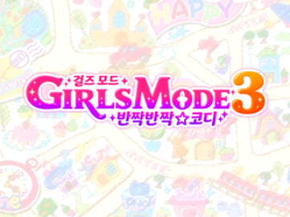
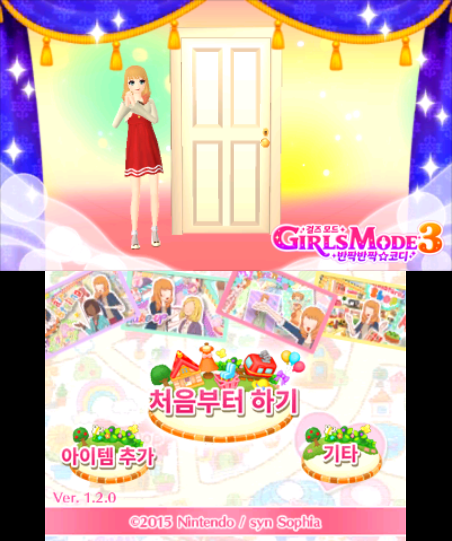
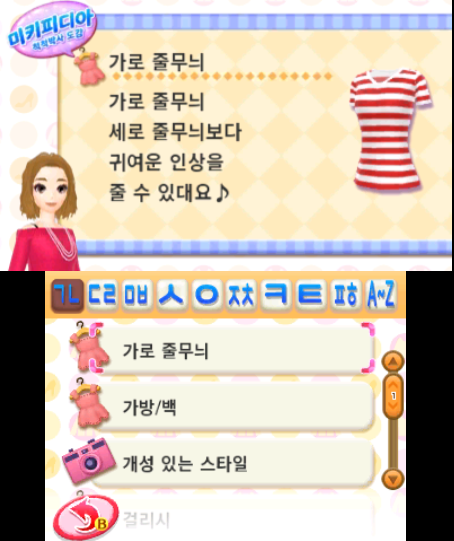

# 걸즈 모드 3 반짝반짝☆코디 한국어 패치

<p align="center"></p>

닌텐도 3DS 일본판 『GIRLS MODE 3 キラキラ☆コーデ』(걸즈 모드 3 반짝반짝☆코디)용 비공식 한국어 번역 패치입니다.
게임 파일은 배포하지 않으며, 본인이 가진 원본(카트리지 덤프 또는 CIA)에 적용하는 차분 패치와 자동 패처만 제공합니다.

> ⚠️ **패치는 반드시 아무것도 적용하지 않은 원본에 적용하세요.**

> ⚠️ **본편 CIA를 다시 설치하면 세이브가 지워집니다.** FBI는 이미 설치된 게임을 지우고 새로 설치합니다.
> 설치 전에 Checkpoint 등으로 세이브를 꼭 백업하세요. 업데이트·DLC CIA만 다시 설치할 때는 세이브가 남습니다.

> **v0.5.0-beta는 초반부를 플레이하며 확인한 시험판입니다.** 모든 손님·이벤트·화면을 확인한 것은 아닙니다.
> 오역, 어색한 문구, 칸을 넘는 글자, 멈춤이 남아 있을 수 있습니다.

## 스크린샷

<p align="center">
  
  
</p>

## 지원 원본

아래 두 가지 중 하나가 필요합니다. DLC는 있으면 함께 패치합니다.

| 원본 | 필요한 파일 | 결과 |
|---|---|---|
| **Rev 3 카트리지** (`Girls Mode 3 - Kirakira Code (Japan) (Rev 3).3ds`) | 덤프 `.3ds`(또는 `.cci`, 그것을 CIA로 바꾼 것) 하나 | 한글 CIA **또는** `.3ds` 하나 |
| **e숍판** | 본편 CIA v0.0.0 + 업데이트 3.3.0 CIA | 본편·업데이트 한글 CIA |
| DLC (선택) | DLC CIA | DLC 한글 CIA |

Rev 3 카트리지는 나중에 찍은 판이라 업데이트 3.3.0 내용이 이미 들어 있습니다. 그래서 업데이트 CIA 없이 덤프 하나로 됩니다.
업데이트 CIA를 같이 넣으면 한글 업데이트도 만들어 줍니다. 설치해도 되고 안 해도 됩니다(어느 쪽이든 똑같이 한글로 나옵니다).

| 항목 | 타이틀 ID | 버전 |
|---|---|---|
| 본편 | `000400000012D800` | v0.0.0 (e숍판) / Rev 3 (카트리지) |
| 업데이트 | `0004000E0012D800` | v3.3.0 (3120) |
| DLC | `0004008C0012D800` | v0.13.0 (208) |

> ⚠️ **확인한 원본은 Rev 3 카트리지와 e숍판뿐입니다.** 초판·Rev 1·Rev 2 카트리지는 덤프가 없어 확인하지 못했습니다.
> 카트리지 덤프는 파일 이름 끝의 `(Rev 3)`로 구분합니다. 다른 판을 넣으면 패처가 어느 파일이 다른지 알려 주고 멈춥니다.

업데이트 3.3.0과 Rev 3 카트리지는 게임 안(타이틀 화면 왼쪽 아래)에서는 **Ver. 1.2.0**으로 표시됩니다. 같은 것입니다.

### 확인에 쓴 원본

```
Girls Mode 3 - Kirakira Code (Japan) (Rev 3).3ds   복호화, 트리밍 안 함
  크기 1,073,741,824   CRC32 3E25040D
  SHA-256 73aedaf5932f8bc8519cae339fe52e9b2f5de45cae7d15534b1bee0cc961feff

본편 CIA v0.0.0 (000400000012D800)   암호화
  크기 828,807,488   CRC32 39B4FC2E
  SHA-256 41745dd3158230ff3c6d71497012a469bc32c7c624823b739acf00248d99fb35

업데이트 CIA v3.3.0 (0004000E0012D800)   암호화
  크기 147,153,920   CRC32 B4DE35B2
  SHA-256 6c76c12fb74a4ef6842884190db3589a8dd482ded7555bcfa91d35fc5d32f5a6

DLC CIA v0.13.0 (0004008C0012D800)   암호화
  크기 9,058,496   CRC32 68242FC6
  SHA-256 c341f2dc6e9cf2acc51c95885f51d7b0c8d039b2c60decb8af57514a4ac4e853
```

**같은 판이라면** 암호화 여부, 트리밍, CIA를 만든 도구 때문에 파일 해시가 위 값과 달라도 괜찮습니다.
패처는 파일 전체 대신 안에 든 게임 파일 하나하나의 SHA-256을 확인합니다. 판이 다르거나 이미 패치된 파일이면 멈춥니다.

키 파일은 **암호화된 파일을 넣을 때만** 필요합니다. 복호화된 덤프·CIA라면 필요 없습니다.

| 파일 | 필요한 경우 |
|---|---|
| `boot9.bin` | 암호화된 CIA·`.3ds` 전부 |
| `seeddb.bin` | 암호화된 e숍판 본편 CIA |

둘 다 본체의 GodMode9으로 만들 수 있습니다. 게임 파일을 GodMode9에서 미리 복호화해 두면 키 파일 없이 됩니다.

## 패치 파일

| 파일 | 크기 | SHA-256 |
|---|---|---|
| `GM3_KR_Patch_v0.5.0-beta.zip` | 19,994,271 바이트 | `ce7801ba2c1f6ad352d24e5a5bbc656eea8e5807431b06fcfa60fefb66e5383c` |

[Releases](../../releases)에서 받을 수 있습니다. ZIP 안에는 자동 패처(윈도우용 실행 bat + 공식 임베디드 파이썬),
파일별 차분 패치(xdelta), 설명서가 들어 있습니다. 게임 데이터는 들어 있지 않습니다.

## 적용 방법

### 자동 패처 (윈도우 10/11)
1. ZIP을 풀고, 게임 파일(과 필요하면 키 파일)을 `한글패치_실행.bat`과 같은 폴더에 넣습니다. 파일 이름은 상관없습니다.
2. `한글패치_실행.bat`을 실행합니다. `.3ds`를 넣었다면 만들 파일을 한 번 묻습니다(Enter = CIA).
3. 같은 폴더에 생기는 `한글패치_결과` 폴더에 한글판이 만들어집니다.
   - Rev 3: `GM3_한글패치.cia` 또는 `GM3_한글패치.3ds`
   - 본편+업데이트: `GM3_본편_한글패치.cia`, `GM3_업데이트_3.3.0_한글패치.cia`
   - DLC를 넣었을 때: `GM3_DLC_한글패치.cia`

- 빈 공간은 결과 파일 크기만큼(약 1GB, 암호화된 파일이면 약 2GB) 필요합니다. 모자라면 시작 전에 알려 줍니다.
- 이미 제대로 만들어진 결과는 다시 만들지 않습니다. 나중에 DLC CIA만 넣고 다시 실행하면 DLC만 만듭니다.

파이썬을 따로 설치할 필요는 없습니다. 맥·리눅스는 파이썬 3.9 이상과 `pip install pyctr` 뒤
`python3 patcher/gm3kr_patch.py <게임 파일 폴더> <출력 폴더> [--cia | --3ds]`로 실행합니다.

### 설치
- **Rev 3로 만든 `GM3_한글패치`**: 일본어 업데이트(3.3.0)가 설치되어 있으면 먼저 지우거나, 한글 업데이트 CIA로 덮어 설치하세요. 일본어 업데이트가 남아 있으면 일본어·빈칸이 섞여 나옵니다(업데이트를 지워도 세이브는 남습니다). 나중에 e숍에서 일본어 업데이트를 받았을 때도 같습니다.
  - 실기: FBI로 `GM3_한글패치.cia` 설치
  - Citra / Azahar: CIA 설치, 또는 `.3ds`를 바로 열기
  - 플래시카트: `GM3_한글패치.3ds`
- **본편+업데이트**: FBI로 본편·업데이트(·DLC) CIA를 설치합니다. Citra / Azahar는 파일 → CIA 설치.
  - 한 번에 설치하기: CIA를 SD카드의 한 폴더에만 모아 두고, FBI에서 그 폴더로 들어가 맨 위 `<current directory>` → **Install all CIAs**를 고르면 차례로 모두 설치됩니다.
- 어느 쪽이든 위의 세이브 주의를 꼭 읽어 주세요.

## 현재 상태 (v0.5.0-beta)

- 대사·선택지·메뉴·아이템/가구 이름·손님 프로필·미키피디아 등 게임 안 문장 전체를 한국어로 옮겼습니다.
- 글자가 그림으로 된 버튼·제목·로고 약 370장을 한글로 다시 그렸습니다.
- 손님 이름·호칭에 맞는 조사(은/는, 이/가 …)와 말투에 맞는 1인칭(나/저)·인사가 자동으로 붙습니다(실행 코드 수정).
- 홈 메뉴 제목·배너, 전자 설명서, DLC 아이템 이름도 한글입니다. 홈 메뉴와 설명서의 한글은 한국어 글꼴이 있는 본체(한국판 등)·에뮬레이터에서 보입니다.
- 이름 입력은 본체의 시스템 키보드를 씁니다. 한국어 키보드가 있는 본체(한국판, 또는 Citra/Azahar)에서 한글 이름을 입력할 수 있습니다. 한글은 완성형 2,350자(KS X 1001)만 표시됩니다.
- 돈 단위는 원작 그대로 엔입니다.
- 확인 환경: 실기와 Citra.
- Rev 3 카트리지 덤프 하나로 업데이트까지 합친 한글판을 만들 수 있습니다.

### 알려진 문제

- 모든 손님·이벤트를 확인하지는 못했습니다. 손님에 따라 말투나 줄바꿈이 어색한 곳이 있을 수 있습니다.

문제를 발견하면 Issues에 장면, 스크린샷, 사용한 환경(실기/에뮬레이터)을 함께 알려 주세요.
멈춤이면 멈추기 직전에 한 조작과, 실기라면 오류 화면 사진도 같이 적어 주시면 빨리 찾을 수 있습니다.

## 변경 이력

### v0.5.0-beta (2026-10-18)
- 첫 공개 시험판입니다. 번역 전체 검수를 마치고, 초반부를 실기와 Citra로 플레이하며 확인했습니다.

## 글꼴·포함된 프로그램

이 패치는 글꼴 파일을 담지 않고, 아래 글꼴로 미리 그린 글자 그림만 게임 자료에 넣었습니다.

| 쓰인 곳 | 글꼴 | 라이선스 |
|---|---|---|
| 게임 글꼴(대사·메뉴), 다시 그린 그림 글자 | Noto Sans KR | [SIL OFL 1.1](licenses/OFL-NotoSansKR.txt) |
| 이름 색인 탭 글자 | 나눔스퀘어라운드 EB | [SIL OFL 1.1](licenses/OFL-NanumSquareRound.txt) |

자동 패처에는 공식 임베디드 파이썬(PSF 라이선스)과 pyctr(MIT), pycryptodomex(BSD/퍼블릭 도메인)가 들어 있습니다.
각 라이선스는 ZIP의 `python/` 폴더 안에 함께 있습니다.

## 면책

- 이 프로젝트는 팬 번역이며 닌텐도, 신소피아와 관련이 없습니다.
- 걸즈 모드(わがままファッション GIRLS MODE)와 관련 상표·저작물의 권리는 각 권리자에게 있습니다.
- 게임 파일과 본체 키 파일은 제공하지 않습니다. 본인이 소유한 원본으로만 사용해 주세요.
- 패치 사용으로 생긴 문제에 대해 책임지지 않습니다.
